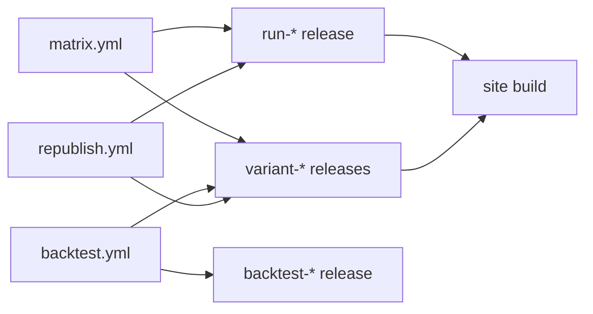

# From a measurement to the site

This document follows a result from the job that measures it to the page
that shows it. It describes what the workflows and scripts do today.
[`DESIGN.md`](../DESIGN.md) is the contract for the measurement itself
(what is seeded, how a header is scored, the schema of `results.json`).

## The short version

1. A job measures one variant. It writes `results/raw/<variant>.json`.
2. `cpm aggregate` turns raw files into `results.json`.
3. The workflow publishes `results.json` as an asset of a GitHub Release.
4. The workflow also files each variant it measured under its tracer
   version, in that variant's own release.
5. The workflow calls a Netlify build hook. The site build downloads the
   releases and renders the pages.

Nothing is committed back to this repository. Releases are the only place
where results are kept.

## Three kinds of release

| Tag | What it holds | Assets | Written by | Read by the site |
| --- | --- | --- | --- | --- |
| `run-YYYY-MM-DD[.N]` | Every variant at one moment | `results.json`, `MATRIX.md`, `changes.json`, `raw.tar.gz`, `logs.tar.gz` | `matrix.yml`; `republish.yml` replaces `results.json` and `MATRIX.md` | The newest 12: `results.json` and `changes.json` |
| `backtest-<variant>-<version>` | One variant at one older tracer version | `results.json`, `MATRIX.md`, `raw-<variant>.json`, `relay-<variant>.log` | `backtest.yml` | No |
| `variant-<id>` | Every tracer version measured for one variant | `<version>.json` for each version, `index.json`, `versions.json` | `matrix.yml`, `backtest.yml` and `republish.yml`, all through `scripts/publish-versions.sh` | `versions.json` |

The site uses the two kinds it reads for different pages:

- `run-*` releases are behind the scorecard, the tool and language pages,
  the detail pages of the latest run, the run archive and the changelog.
- `variant-*` releases are behind the pages for one tracer version and the
  history pages.

A `backtest-*` release is the record of one back-test job. The same
measurement is also filed in the `variant-*` release, which is the copy
the site reads.

## One measurement

Three programs take part. The driver sends a request with seeded headers
to the relay over one protocol. The relay forwards it to the sink over a
second protocol. The sink records the headers that arrived.

One variant is one relay image: a language, a tool, and a way to attach
the tool. A job runs every boundary of `variants.yaml` for its variant
and writes `results/raw/<variant>.json`. That file holds, for each hop,
the headers that were seeded, the headers that arrived, and a status for
each header.

## `matrix.yml`: measure variants and publish a run

### When it starts

| Trigger | What it measures |
| --- | --- |
| Monday 06:17 UTC | Every variant |
| Manual dispatch | The variants you name. The default is every variant |
| Push to `main` that changes a path in the workflow's `paths` list | The variants the push can affect, and the stale ones |
| Every 6 hours, at minute 53 | The stale variants. It starts no job when there are none |

A variant is stale when its inputs have changed since the commit at which
it was last measured.

The 6-hourly run exists because a merge does not always start a run that
measures it:

- GitHub starts no push run for a merge made with a workflow's own token.
  `bump-agents.yml` merges tracer bumps that way.
- Only one run can wait behind a running one. A newer run replaces the
  one that is waiting.
- A job can fail.

### Which variants: the `plan` job

`cpm affected` chooses the variants. It has two modes, and a push run
uses both:

- `-base <commit before the push>` selects the variants the pushed change
  can affect. The rules are in `internal/affected`:

  | Changed path | Variants selected |
  | --- | --- |
  | `driver/`, `sink/`, `proto/`, `gen/`, `docker/`, `internal/eval/`, `internal/raw/`, `go.mod`, `go.sum`, `.dockerignore`, `matrix.yml` | Every variant |
  | A file under a relay's source directory | The variants built from that directory |
  | `variants.yaml` | The variants whose definition changed, and new ones |
  | `docker-compose.yml` | The variants whose `relay-<id>` service changed. Every variant when a broker, the sink, the driver or another top-level key changed |
  | `annotations/`, `cmd/`, other `internal/` packages, `scripts/`, other workflows, `*.md`, `pins.yaml` | None |
  | Any other path, and a file under `relays/` that belongs to no variant | Every variant |

- `-since results.json` selects the stale variants. The latest release
  records, for each variant, the commit at which it was measured
  (`measured_commit`). `cpm affected` applies the rules above to the
  change from that commit to the current one.

New Relic variants are left out when the `NEW_RELIC_LICENSE_KEY` secret is
not set.

### Measuring: the `run` jobs

There is one job for each selected variant. The jobs run in parallel.
Each job:

1. Builds the sink, the driver and the relay image. Image layers are
   cached in GHCR.
2. Starts its own Kafka, RabbitMQ and sink.
3. Starts the relay and runs the driver. If the driver fails, the job
   restarts the relay and runs the driver once more.
4. Uploads `results/raw/<variant>.json` and the relay log as an artifact.

### Publishing: the `aggregate` job

The steps run in this order:

1. **Find the previous run.** `scripts/fetch-latest.sh` names the newest
   `run-*` release: the latest date, then the highest `.N`. The job
   downloads its `results.json` and `raw.tar.gz`.
2. **Carry over.** The job unpacks the previous raw files, then copies
   the raw files of this run over them. There is now a raw file for every
   variant: a new one for each variant measured in this run, and the
   previous one for each of the others.
3. **Name the variants that failed.** A variant that the plan selected
   and that produced no raw file keeps its previous result. The job
   prints a warning that names it. If no variant produced a raw file, the
   job stops here and publishes nothing.
4. **Choose the run id.** `run-<UTC date>`, then `.1`, `.2` and so on for
   later runs on the same day.
5. **Aggregate.** `cpm aggregate` writes `results.json`, `MATRIX.md` and
   `changes.json`. `changes.json` is the difference from the previous
   run: cells that changed, variants added or removed, tracer versions
   that moved.
6. **Gate.** `cpm gate` stops the job when a variant measured in this run
   is not a valid measurement: the control header reached the sink, a hop
   arrived over the wrong protocol, a boundary was not run, or the agent
   never attached. The same problem on a carried-over variant is a
   warning only.
7. **Open a pull request for resolved annotations.** When every cell of
   an annotation now passes, the job opens a pull request that marks the
   annotation fixed.
8. **Publish the release.** `scripts/create-release.sh` creates
   `run-…` with the five assets. The tag is put on the measured commit.
   If GitHub refuses that with a 403, the tag is put on the tip of `main`.
9. **File by version.** `scripts/publish-versions.sh` files each variant
   measured in this run in its `variant-<id>` release. See below.
10. **Rebuild the site.** The job calls the Netlify build hook
    (`NETLIFY_BUILD_HOOK_URL`).
11. **Tell Slack.** One message when cells, variants or versions changed.
    One message when a variant could not be measured. Both need the
    `SLACK_WEBHOOK_URL` secret, and are skipped without it.

Steps 7 to 11 run only on `main` and only when the `publish` input is
true.

### What a run records about carry-over

A run release shows the latest known result of every variant. Some of
those results were measured in an earlier run. `results.json` says which:

| Field | Meaning |
| --- | --- |
| `run.partial` | `true` when the run measured only some variants |
| `run.reran` | The ids of the variants measured in this run |
| `variants[].measured_in` | The run that measured this variant |
| `variants[].measured_commit` | The harness commit that run measured |
| `variants[].ran_at` | When the variant's hops ran |
| `variants[].matrix_version` | The measurement contract the variant was scored under |
| `variants[].tracer.pinned` | The tracer version the pin held when the relay was built |
| `variants[].tracer.version` | The tracer version the relay reported at run time |

## `backtest.yml`: measure older tracer versions

A back-test measures an older release of a tracer with the harness as it
is today: the relay application, the runtime and the libraries of the
current commit. It shows how that tracer version behaves in today's
relay. It does not reproduce the result that version had when it was
current.

The workflow starts on the first day of each month at 03:23 UTC, or by
hand.

1. **Plan.** `cpm discover` lists pairs of a variant and an older
   version. For each variant it takes the newest `depth` stable versions
   that are older than the current pin (`depth` is 5 by default). It
   leaves out the versions that `pins.yaml` rules out with `backtest:`.
   It also leaves out the pairs that are already measured, unless the
   `refresh` input is true. One dispatch takes at most 250 pairs.
2. **Measure.** There is one job for each pair, 30 at a time. The job
   runs `cpm pins set` to move the pin back in its own checkout, builds
   the relay with the unchanged Dockerfile, and runs every boundary. The
   changed pin is never committed.
3. **Check the version.** The relay reports the tracer version it runs.
   If that is not the version the job asked for, the job fails and
   publishes nothing.
4. **Gate.** As in `matrix.yml`, with one difference: an agent that
   never attached is published and marked `invalid: agent_inactive`. The
   fact that an old version does not attach is worth keeping, and an
   unpublished pair would be measured again every month.
5. **Publish.** The job creates the pre-release
   `backtest-<variant>-<version>`. On a refresh it replaces the assets of
   the existing release.
6. **File by version.** One job, after all pairs, files each document in
   its `variant-<id>` release and calls the Netlify build hook.

### Limit of `refresh`

A refresh does not skip pairs that are already measured, so every refresh
dispatch selects the same pairs. With the default depth that is at most
five versions for each instrumented variant, which fits in one dispatch.
With a larger depth there can be more than 250 candidates. A refresh then
measures the same 250 pairs each time and never reaches the others.

## `republish.yml`: annotations changed

`results.json` contains the annotation text. A merge that changes only
`annotations/**` starts no measurement, so the latest release has to be
written again:

1. Download `results.json` and `raw.tar.gz` of the latest `run-*`
   release.
2. Run `cpm aggregate -republish` on those raw files at the current
   commit. Cells, the run id and every variant's provenance stay as they
   were. Only the annotations change.
3. Replace `results.json` and `MATRIX.md` on the same release.
4. Write the annotations into every variant's `versions.json` again.
5. Call the Netlify build hook.

## Filing by version: the `variant-<id>` releases

`scripts/publish-versions.sh` keeps one release for each instrumented
variant. A baseline variant has no tracer, so it has no such release.

For each variant it is given, the script:

1. Downloads `index.json` and `versions.json` from the release. It
   creates the release if there is none.
2. Runs `cpm versions`, which writes `<version>.json` from the variant's
   part of `results.json` and puts the entry into `index.json` and
   `versions.json`. The version is `tracer.pinned`.
3. Uploads the three files and replaces the old ones.

`<version>.json` is a `results.json` with one variant. A later
measurement of the same version replaces it. `versions.json` holds the
index and every document, so the site needs one download for each
variant.

The script compares `index.json` with the list of assets each time it
runs. It drops entries whose asset is gone and adds assets the index does
not know. A release that two workflows updated at the same moment is put
right by the next update.

## What the site does

`scripts/fetch-results.mjs` in the site repository runs before each
build. It lists the releases of this repository through the GitHub API
and downloads:

- `results.json` and `changes.json` of the newest 12 `run-*` releases
- `versions.json` of every `variant-*` release

While this repository is private the build needs a `GITHUB_TOKEN` that
can read it. If the releases cannot be fetched, the build fails and the
previous deploy stays up.

The site is built again when a workflow here calls the Netlify build
hook, and when something merges in the site repository.

## One at a time

| Group | Workflows | Effect |
| --- | --- | --- |
| `matrix` | `matrix.yml`, `republish.yml` | A republish never rewrites a release while a run publishes |
| `backtest` | `backtest.yml` | One back-test dispatch at a time |
| `bump-agents` | `bump-agents.yml` | Two runs never rewrite the same bump branch |

A matrix run and a back-test can update the same `variant-<id>` release
at the same moment. The comparison in `publish-versions.sh` described
above is what repairs that.

## What can go wrong, and what catches it

Each row is a fault that happened, or one the code is written to prevent.

| Fault | What catches it |
| --- | --- |
| The wrong release is taken as the previous run. The releases API does not list runs in the order they were published | `fetch-latest.sh` orders by date and number. `scripts/test-fetch-latest.sh` runs in `verify.yml` |
| A merge starts no run, a waiting run is replaced, or a job fails. A variant then keeps a result from older inputs | `cpm affected -since` in every push run and in the 6-hourly run |
| No job of a run produces a result | The `aggregate` job stops and publishes nothing |
| A relay no longer builds. Its last result is carried over and no cell changes | A warning on the run, a line in the release notes, and a Slack message name the variant |
| A measurement is not valid | `cpm gate`, before anything is published |
| A back-test builds a different tracer version than the one asked for | The version check fails the job |
| GitHub refuses to tag the measured commit (403) | `create-release.sh` tags the tip of `main`. `results.json` records the measured commit in any case |
| The measurement contract changes and `matrix_version` does not | `cpm validate` in `verify.yml` compares the registry with the latest release |
| A republish changes which run and commit measured a variant | `cpm aggregate -republish` reads them from the release it rewrites |

## What partial runs save

The figures below are from the 95 runs of `matrix.yml` between 23 October
and 16 November 2026. A runner-minute is one job running for one minute,
rounded up for each job.

| Kind of run | Runs | Runner-minutes |
| --- | --- | --- |
| Measured every variant | 22 | 3,560 |
| Measured 1 to 40 variants | 39 | 1,047 |
| Measured none: 22 found nothing stale, 12 were cancelled before a job started | 34 | 22 |

A run of every variant with a warm cache takes about 10 minutes and about
130 runner-minutes. Three of the 22 took 280 to 351 runner-minutes because
images were built without the cache. The two of those that finished took
about 37 minutes.

If the 39 partial runs had measured every variant, they would have used
about 5,000 runner-minutes instead of 1,047.
